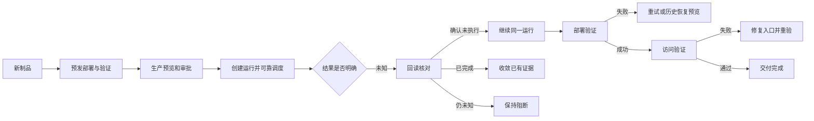

# Devpilot 参考 Pipewright 的功能完善规划

状态：规划已落库；交互以 V3 原型模拟；生产实现待开发、集成与人工验收。
事实来源：[调研](../research/2026-09-20-pipewright/README.md)。实现合同：[技术方案](2026-09-20-pipewright-technical-design.md)。

## 产品目标与范围

让用户从失败现场知道发生了什么、哪些目标已改变、下一项安全动作是什么；让“部署成功”“入口可用”“交付验收”各自有真实证据。

沿用项目概览、发布记录/详情、已有环境配置、Site/域名入口和运行详情。保留现有壳层、四阶段轨道、表格与抽屉；不增加新的顶级“流水线平台”。原型旧导航仅作为存量演示，真实产品导航以当前项目工作台合同为准。

能力标识：CURRENT_SOURCE=源码存在未必运行通过；PROTOTYPE=本次模拟；BACKEND=需补/扩服务端；DEFER=不开放生产。

## 功能与实现目标

| ID/顺序 | 功能、用户触发 | 当前基础 | 目标行为与实现要点 | 完成信号 |
|---|---|---|---|---|
| PW01 / S1 | 新制品重新预发 | 已有 BuildRun / Manifest / Staging | 完成判断绑定 manifest+配置快照；新构建单独验证；不可变来源变化则新发布单 | A 已通过后 B 能验证；B 未通过前不能生产 |
| PW02 / S1 | 生产中断后继续 | 已有 resume/reconcile 接口，UI 有冻结问题 | 先回读；unknown 不重放；同运行安全续接；接入已有服务前核验其状态前置条件 | 断网、刷新、重复点击不产生第二次部署 |
| PW03 / S1 | 失败就地恢复 | 已有 recovery preview/confirm | 结果区直达历史版本；显示影响、配置与数据限制；产生新恢复记录 | 失败证据保留，成功验证后更新版本 |
| PW04 / S2 | 按目标分批、暂停与中止 | 基础执行 Provider 存在；批次合同需补 | 显示各目标版本；中止仅阻止未执行任务；部分成功不算整体完成 | 3 台中第 2 台失败，第 3 台不执行，结果可解释 |
| PW05 / S2 | 部署后访问验收 | Site/路由/探测代码存在，需聚合核验 | 域名、TLS、HTTP 和工作负载结果分开；失败可重验，不重部署 | 健康通过但 TLS 失败时不能显示交付完成 |
| PW06 / S3 | 任务模板与缓存 | 现有构建执行器、项目分析 | 版本化模板、输入校验、缓存按工具链/锁文件/隔离域；保留人工审阅 | 缓存命中可解释，跨团队不读到秘密或产物 |
| PW07 / S3 | PR 临时预览 | 既有相关骨架需要现场核验 | SCM PR ID+head SHA 为身份；独立权限/容量/TTL/回收与域名状态 | 任意合法分支名可预览；合并后资源与路由回收有收据 |
| PW08 / S1 | 接入凭据失败恢复 | credential-options API 存在 | 区分无数据、403、网络故障；保留输入并重试 | 请求失败不诱导重复创建凭据 |

## 页面映射

| 存量页面 | 增补内容 | 交互边界 |
|---|---|---|
| 发布详情 / 预发 | 当前候选与已验证制品、重新预发动作 | 默认产品版本，技术 digest 收进证据 |
| 发布详情 / 生产 | 待核对/可继续/部分失败、当前可执行动作 | 一项主操作；unknown 仅核对，不能强制继续 |
| 部署运行抽屉 | 目标、批次、运行版本、尝试和错误原因 | 全部成功/部分失败/未执行明确区分 |
| 项目配置 / 版本 | 恢复预览与确认复用 | 成功前保留当前指针，恢复不等于数据库回滚 |
| 发布详情 / 验证 | DNS、TLS、HTTP、探测时间和重新验证 | 不将工作负载成功等同于公网验收 |
| 项目配置 / 域名入口 | 显示探测阻断并定位配置 | 复用现有 Site，不新增独立代理管理后台 |
| 项目接入 | 凭据错误与重试 | 不能将错误转成空列表 |

## 用户状态流程

## 本次原型范围

新增 5 个情景：新制品重验、生产中断、首批暂停、部分失败、入口未通过。复用同一发布详情及操作确认层样式，模拟读回/继续/中止/恢复/重验。每个发布的演示状态保存在 sessionStorage；不连接 API，清空情景有明确重置按钮。保留“原有入口配置流程”切换。

原型并未覆盖：真实审批人交互、并发租约、未知结果持续失败、真实 PR/DNS/证书创建、全部配置冲突。它们属于实现验收矩阵，不用原型按钮代替技术实现。

## 不采用

不迁移 Pipewright 单管理员模型，不引入第二套发布状态机；不把主机分批命名为流量灰度；不将 Caddy 选型直接替换既有 Site Provider；不开放未经验证的自动蓝绿/指标回滚。通用 DAG 编辑器排在模板验证之后。

## 交付切片与准入

1. S1：PW01/PW02/PW03/PW08。先实现具体异常闭环，DB+API+浏览器测试后人工验收。
2. S2：PW04/PW05。先验 Provider 能力、可回读性与部分失败，再开放控制。
3. S3：PW06/PW07。先做一个 Node 构建模板和一个隔离 PR 预览，量化接入成本后扩展。

量化门槛：所有重复动作保持同一逻辑运行；所有 unknown 禁止重放；跨团队/环境对象请求均拒绝；未完成目标不得隐藏；恢复留完整历史；DNS/TLS 无实际证明不得标“访问通过”。不开时间承诺，按证据逐片推进。
