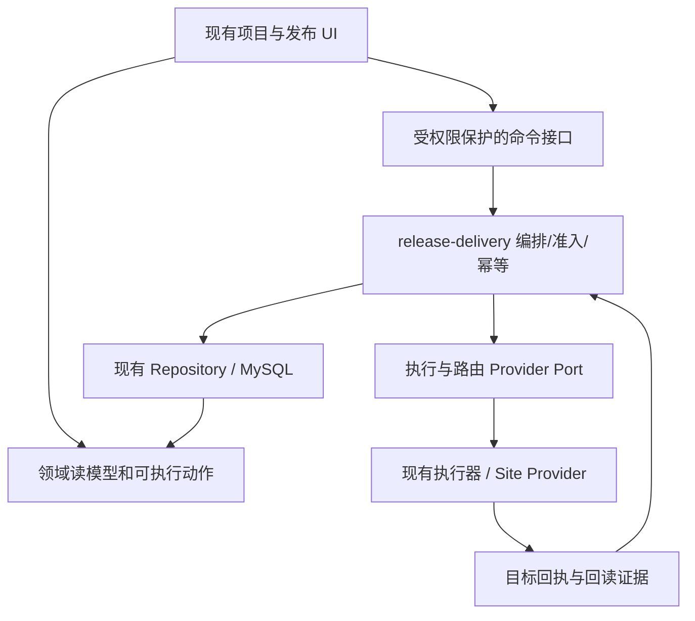

# Pipewright 参考改进：技术方案与验收合同

状态：设计提案，生产代码未实施。关联 [功能规划](2026-09-20-pipewright-improvements.md) 与 [研究来源](../research/2026-09-20-pipewright/README.md)。

## 1. 既有路径先复用

以下路径相对 `apps/devpilot-api/src/`：

- `release-delivery/environment-version.controller.ts` 已暴露 `:environmentId/production-promotion/reconcile`、`resume`、`actions`、`recovery/preview` 和恢复确认路径。reconcile 具有特定历史/异常状态适用条件，不可当成所有失败的通用接口。
- `production-promotion-reconcile.service.ts` 通过 SiteRouteSwitchSagaReadbackService 回读 committed / not_switched / unknown；不明确时阻断。
- `release-deployment-provider-profile.ts` 支持显式启用的 local-filesystem-v1 / ssh-v1。高级策略能力不由前端名称推断。
- `release-gate-recovery-strategy.provider.ts`、`release-gate-runtime-capability.provider.ts` 存在 unavailable 能力；不得因原型演示解除门禁。

前端当前入口在 `apps/devpilot-web/src/app/(dashboard)/projects/[id]/components/release-workbench/`：release-basic-production-stage、release-basic-staging-stage；生产创建与执行在 `hooks/use-production-releases.ts`、`execute-basic-production-release.ts`。配置恢复复用 environment-version-recovery-control。

## 2. 分层与边界

不新增 Pipewright 微服务或第二个控制面。新持久化字段/表须先审计现有 schema，能从运行和回执推导的状态不重复保存。接口 DTO、领域编排、数据访问、Provider 和 UI 分别归属原模块，不写跨层万能工具文件。

## 3. PW01：制品轮次

- 预发证明必须关联 releaseOrderId、artifactManifestId、环境、有效配置/资源/密钥引用快照以及验证状态。
- 页面“完成”应针对当前候选，不能只看最后一个成功部署。更换候选或影响部署的快照后重新检查。
- 发布单来源不可变；如代码 commit 变化，创建新发布单。相同发布单的合法重建产生新 Manifest，也必须重新预发。
- 旧证明留历史；生产输入只能取匹配候选和快照的有效证明。不能默认把最新构建当已通过。

## 4. PW02：中断、幂等、调度

第一步复用现有 resume/reconcile 的 readback、租约和状态 CAS，列清“可继续/仅核对/需要恢复/已终态”的服务端动作集合。若现有接口仅覆盖 legacy promotion，应扩展领域服务的适用场景或新增明确命令，不能直接绕过准备过程调用 Provider。

| 输入/读模型（拟议扩展） | 规则 |
|---|---|
| scope | team/project/order/environment 全链匹配 |
| releaseRunId / operationId | 必须绑定原运行和目标收据 |
| idempotencyKey | 一次逻辑动作固定；重复请求返回相同操作结果 |
| expectedInputHash / stateVersion | 配置、审批、目标或状态漂移返回冲突，刷新预览 |
| availableActions / blocker | 服务端生成；前端据此展示，不能用“有运行”全冻结 |
| targetReceipts | 区分执行成功、未执行和未知；支持精确回读 |

创建与派发间的可靠性优先使用现有持久化队列/恢复机制；若存在缺口，增加事务 outbox：创建运行与派发意图同事务落库，Worker 至少一次消费，Provider 操作用稳定 operationId 去重。禁止仅靠浏览器连续两个 POST 保证派发。此处是设计决策，是否新增 outbox 由现有队列审计决定。

unknown → readback；committed → 收敛证据；not_started → 通过最新准入后 resume；仍 unknown → 阻断。已成功目标不因“重试”重新执行。只对确定失败/未执行目标按既有运行尝试模型创建受审计 attempt。

## 5. PW03/PW04：恢复与分批

- 恢复：调用现有 recovery preview/confirm，绑定 sourceVersionId 与输入 hash；展示配置和数据兼容性限制。只恢复受支持的应用/配置，不承诺数据库逆迁移。
- 恢复成功后通过现有版本提交路径追加记录与更新指针；原失败记录不删除。成功回执不足时不更新版本。
- 批次计划：固定目标清单/顺序、批量、maxParallel、健康门槛、暂停点；快照进入审批输入。枚举只是提案，迁移先核对当前模型。
- 目标状态：pending/running/succeeded/failed/unknown/skipped。批次暂停不是失败，中止只停后续调度，已成功目标是否恢复另行确认。
- 同环境并发保护、取消令牌、Worker 重启与租约过期都要读回。蓝绿/流量权重/指标自动回滚继续 DEFER，直到 Provider 和故障测试通过。

## 6. PW05：部署与访问验收

复用 Site 配置及路由 Provider；新增或扩展交付摘要，分别返回 workload、route、dns、tls、http 的 status/checkedAt/receipt。版本部署成功和公网交付成功是两个事实；版本指针提交沿用现有生产准入/验证合同，不因本规划擅自提前。

重验只创建探测记录，不重复创建 DeploymentRun。不支持或无法探测时返回 unavailable/unknown，不能当 success。域名配置入口携带 project/environment/site 上下文。

旧 Traefik 规划中的“通过 API 写动态权重”不能未经当前 Provider 源码与上游文档核验直接采用；本方案只依赖现有 Port，不预设代理实现或新增 Caddy。

## 7. PW06/PW07：后续扩展

模板：定义 version、typed inputs、secret refs、image digest、outputs；输入由服务端校验。缓存 key 包含团队隔离域、工具链、锁文件 hash 与构建配置；不缓存明文密钥。产物重新校验后接入已有 Manifest，不能另建一套制品真实性。

PR 预览：用 provider/repositoryId/prNumber/headSha 标识；支持任意分支名。专属命名空间/资源标签、凭据最小化、并发配额、TTL；创建与销毁都是可重试任务。SCM 状态证实 closed/merged 才自动回收；失败显示 orphaned/cleanup_pending，保留收据。未受信任 PR 不能读取生产秘密。域名创建失败与构建/部署状态分别反馈。

## 8. 迁移、发布、回退

新增能力默认关闭，由 Provider capability + 团队权限共同决定可用动作。先做兼容的新增字段/索引，历史运行只有证据充分才填充动作；unknown 不能猜测补成功。后端兼容旧客户端，再更新前端。关闭开关应禁止新动作但保留进行中任务收敛、只读和历史审计；不可通过删表或改指针回退。

## 9. 验收矩阵

| 场景 | 必须证明 |
|---|---|
| A 预发后 B 重建 | B 无有效证明不能生产；A 记录保留 |
| 创建后断网/进程重启 | 能找回原运行，重复点击不重复执行 |
| 目标已执行但响应丢失 | 回读收敛，禁止盲目重放 |
| 审批/配置过期 | 冲突后重新预览，旧输入不可继续 |
| 多机第 2 台失败 | 显示逐台事实，第 3 台按策略停止 |
| 中止与历史恢复 | 中止不假装回滚；恢复新记录，失败不改当前指针 |
| DNS/TLS 不可达 | 部署与访问分别显示；重验不重部署 |
| 跨团队/跨环境 ID | API 拒绝且没有 Provider 副作用 |
| Worker/缓存/日志 | 无明文秘密，缓存隔离，幂等键与回执可追溯 |

验收层次：状态单元测试 → 真实 DB/权限/并发集成 → 隔离 Provider 与故障注入 → 浏览器操作 → 人工验收。原型只证明交互方向，本次未实施上述生产合同。
