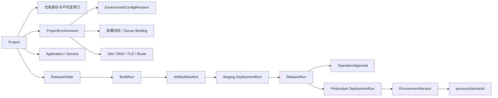

# Devpilot 项目模块全功能 PRD

## 1. 模块定位

项目模块把一个代码仓库转化为可审计、可配置、可发布、可恢复的交付对象。用户必须能够从“这个项目现在是什么状态”进入“下一步具体做什么”，并在发布到生产前看到真实门禁、审批和运行证据。

## 2. 目标与非目标

### 2.1 目标

- 覆盖项目目录、接入、项目信息、仓库分析、发布、环境配置、域名入口和部署证据；
- 让项目、环境、发布单、制品、部署运行和环境版本的关系可理解；
- 把阻断原因、影响和修复路径放在同一上下文；
- 保留服务端准入、审批、并发保护、不可变证据和审计边界；
- 形成可由 Stitch 连续生成的页面和状态合同。

### 2.2 非目标

- 不把服务、Run、Manifest、Gate 等后端对象全部提升为一级导航；
- 不允许配置页创建任意环境；项目接入阶段拥有基线环境创建；
- 不把预发成功自动等同于业务验收或生产成功；
- 不设计灰度、蓝绿、自动发布、真实流量切换或指标驱动自动回滚为已可用功能；
- 不允许通过前端直接修改当前环境版本指针。

## 3. 用户任务

| 用户 | 任务 |
| --- | --- |
| 项目负责人 | 纳管仓库、确认组件、补齐交付基线、查看当前生产和创建发布 |
| 开发成员 | 选择版本与提交、查看构建/预发结果、修复代码或配置问题 |
| 运维成员 | 维护部署目标、资源、变量/密钥、域名入口、监控与恢复 |
| 审批者 | 核对不可变生产预览、风险、证据新鲜度并作出审批决定 |
| 审计者 | 从发布单追溯 BuildRun、Manifest、DeploymentRun、ReleaseRun、EnvironmentVersion 和审计事件 |

## 4. 目标信息架构

### 4.1 项目级入口

| 入口 | 目标路由/落点 | 主要问题 |
| --- | --- | --- |
| 项目信息 | `/projects/:id` | 仓库、分支、策略、组件和解析依据是什么 |
| 发布 | `/projects/:id/releases` | 当前有哪些发布单，下一阶段能否执行 |
| 项目配置 | `/projects/:id/settings` | 选定环境的版本、目标、资源、变量、权限和验证如何配置 |
| 域名与入口 | `/projects/:id/domains` | 项目在各环境如何被访问，DNS/TLS/转发是否就绪 |
| 部署记录 | `DESIGN`：项目级运行目录；当前可映射到 `/projects/:id/releases?deploymentRunId=...` 和发布历史抽屉 | 哪次部署运行了什么、结果和证据是什么 |

目标 Stitch 设计保留这五类任务的可见入口。实际实现可以让“部署记录”进入发布历史/运行抽屉，但用户不能通过猜测发布单才能找到 DeploymentRun。

### 4.2 项目页头

- 面包屑：`项目 / 项目名`；
- 标题：项目名；
- 副信息：仓库 URL、默认分支，可点击仓库时显示外链图标；
- 唯一主操作：`创建发布`；
- 项目配置、域名入口等是上下文导航，不与主操作竞争；
- 缺少生产入口、部署目标或配置时，在导航下方显示紧凑问题条。

## 5. 领域对象与真相边界

真相边界：

- 仓库身份、分支和 commit 来自已锁定的仓库修订；
- 当前配置来自环境当前不可变配置修订；
- 发布生命周期来自服务端 `lifecycle`，不是前端根据数量猜测；
- 构建成功必须产生不可变 Manifest；
- 生产只能复用已通过预发的同一 Manifest；
- Production Preview 的 `inputHash` 是确认输入，变化或过期后必须重新预览；
- 生产完成后才创建 EnvironmentVersion；
- 恢复是新 ReleaseRun/DeploymentRun/EnvironmentVersion，不删除历史。

## 6. 全流程

## 7. 功能需求

### 7.1 项目目录

#### 7.1.1 数据与字段

`LIVE`：

- 摘要：总项目数、运行中项目数、待配置项目数；
- 搜索：项目名、仓库或域名；
- 状态筛选：全部、运行中、待配置；
- 表格列：项目、状态、组件、线上版本、最近发布时间、可选环境列、操作；
- 项目副行仅展示真实 `projectType + architecture`；
- 组件以 `名称:端口` 紧凑展示，完整列表放 hover/focus 浮层；
- 线上版本展示生产当前版本与生产域名；
- 动态环境列默认隐藏，用户可配置显示，生产环境不重复生成动态列；
- 排序以最近活动或最近发布为主，界面明确排序口径。

#### 7.1.2 状态与动作

- 项目状态只有 `运行中` 和 `待配置` 两个目录级投影；
- 若服务端给出 `nextAction`，首个行操作是准确修复动作；
- 常用动作：进入项目、发布、项目配置；
- 低频动作：域名与入口及其他受支持动作放省略菜单；
- 过滤无结果提供“清除筛选”；真实空目录提供“创建项目”；
- 加载失败保留页面壳层并提供重试。

### 7.2 创建项目与仓库接入

#### 7.2.1 步骤 1：连接仓库

`LIVE`：

- 必填：仓库地址、可见性；
- 私有仓库：凭证模式（受管引用/本次输入）、凭证类型（HTTPS Token/SSH Key）、名称、用户名、密钥；
- 可选：项目名、分支、描述；
- 草稿已存在时说明草稿会保留；
- 提交后创建/续用项目草稿、连接仓库并启动分析；
- 重复仓库、凭证无效、分支不存在、仓库不可读分别显示可执行修复建议。

#### 7.2.2 步骤 2：解析与人工审核

`LIVE`：

- 运行状态：queued、running、succeeded、failed、cancelled；
- 运行中显示当前阶段，不伪造百分比；
- 失败提供“按固定输入重试”和“重新连接仓库”；
- 成功显示默认分支、选定分支、精确 commit、凭证引用；
- 显示项目类型、架构、包管理/运行时等分析事实；
- 组件建议逐项接受、拒绝或修订；
- 依赖与配置建议必须人工确认，未审核建议不能修改项目事实；
- 原始解析证据在折叠详情中。

#### 7.2.3 步骤 3：确认基线

`LIVE`：

- 展示 Staging 和 Production 两个默认基线环境及其用途；
- 展示项目名、仓库、分支、commit、审核快照 hash；
- 展示最终接受的组件：名称、路径、类型、构建产物、运行方式；
- 明确部署目标、资源、变量、域名等在项目配置中继续完成；
- 完成后锁定仓库身份、审核快照和基线拓扑并进入项目信息。

### 7.3 项目概览与项目信息

#### 7.3.1 项目概览

`DESIGN`，使用现有数据组合：

- 当前生产：版本名 + `x.y.z`、来源分支/commit、上线时间、运行组件数量与健康摘要；
- 唯一 blocker：只显示当前最需要处理的一项；
- 最近发布：版本、环境、结果、完成时间；
- 组件：名称、类型/运行时和真实状态；
- 主操作：创建发布；
- 不展示当前数据无法证明的 owner、变更数量或伪实时健康度。

#### 7.3.2 项目信息

`LIVE`：

- 基本事实：仓库地址、默认分支、当前发布策略（只读 + 解释 tooltip）；
- 发布入口摘要：当前是否存在 blocker，进入发布；
- 组件表：名称、路径、类型/运行时、端口、状态和最近审核变更；
- 组件变更显示可读摘要；raw recommendation JSON 只在技术证据中；
- 仓库分析记录放折叠区，支持选择具体 run；
- 新分析必须绑定明确 branch/commit；
- review/apply 后才更新组件和配置事实。

### 7.4 发布单列表与创建

#### 7.4.1 列表

`LIVE`：

- 搜索发布版本或来源；
- 状态过滤；
- 表格列：发布单/版本、状态、来源、当前阶段、最近执行、操作；
- 发布名与版本同时显示，如“图库重构 1.4.0”；
- 历史时间戳版本标记为“历史记录”，不伪装成规范版本；
- 版本和发布单号可进入详情；
- 行操作：查看发布单、查看构建、查看部署、查看技术证据；
- 构建/部署/证据尽量在当前列表以抽屉打开，只有查看发布单进入详情。

#### 7.4.2 创建发布

`LIVE`：

- 必填：发布名称（最多 100 字符）、规范版本 `major.minor.patch`；
- 可选：发布说明（最多 2000 字符）；
- 非 `x.y.z` 输入就地报错；
- 主操作禁用时在下方常驻显示原因；
- 取消清空本次草稿；
- 创建成功进入新发布单详情；
- 发布单创建时冻结当前发布策略快照和后续准入所需项目作用域。

### 7.5 发布工作台

#### 7.5.1 页头与决策区

- 标题：`发布名 版本号`，副信息展示发布单号和来源；
- 状态来自服务端 lifecycle：draft、building、staging、awaiting_approval、production、succeeded、failed、withdrawn；
- 标题下只显示一个紧凑决策条，回答“当前能否继续、卡在哪里”；
- 决策条计数来自当前阶段决策，不把全目录计数混入当前阶段；
- 阻断时显示门禁原因和精确修复入口；
- 技术 ID 用短值展示，完整值进入 title 或证据抽屉。

#### 7.5.2 环境链与步骤

- 一级环境链：预发发布 → 生产发布；
- 预发内部步骤：前置检查 → 构建 → 部署/验证；
- URL `step` 只代表用户查看的历史步骤，真实执行位置来自服务端；
- 完成、当前、等待、阻断、不可用五态均有图标和文字；
- 支持方向键、Home、End 切换步骤；
- 一个页面只保留与当前阶段相关的主操作。

#### 7.5.3 Gate Catalog

`LIVE`：

- 门禁阶段：commit、build、deploy、promote；
- 展示动态目录，不在设计中写死条目数；当前审计样本为 51 项；
- 检查状态：checked、unchecked、blocked、warning、manual、unavailable；
- 持久化状态：pending、passed、warning、failed、unavailable、needs_human；
- 展示当前阶段 decision：allowed、blocker、manual、warning、deferred、evidence-only；
- 能力组显示业务名称，不展示内部 Mxx 编号；
- 能力组行是可点击过滤器，重复点击返回全量；
- manual 检查只有当前 evaluationId/inputHash 仍有效时可确认；
- 证据过期、输入变化或完整性错误必须使决策失效；
- 门禁弹窗只有一个滚动区域。

#### 7.5.4 构建

`LIVE`：

- 从锁定的仓库 branch/commit 启动 BuildRun；
- 展示 revision、来源、状态、开始/结束时间和错误摘要；
- 成功后生成 ArtifactManifest 与 digest；
- 支持多轮构建；首次生产 ReleaseRun 后冻结用于生产的制品；
- 运行中支持取消，失败支持基于当前准入重新构建；
- 构建历史和日志在抽屉显示；
- 日志只有一个滚动区域，错误码先翻译成业务标题，原始输出次级展示。

#### 7.5.5 预发部署与验证

`LIVE`：

- 只能部署最新可用的成功 Manifest；
- `publish.disabled = 无可部署制品 ∨ staging gate 阻断 ∨ targetReadiness 非 ready ∨ 正在部署`；
- target readiness 必须区分 missing、duplicated、provider_mismatch、ssh_root_invalid、ssh_connection_invalid；
- 原因需要点名环境、期望 provider 和修复入口；
- 创建 DeploymentRun 后展示运行级状态：已创建、运行中、终态与证据；
- 不把执行器内部未持久化微步骤伪装成实时日志；
- 终态才展示结果和保留日志；
- 支持部署历史、运行详情和日志抽屉。

#### 7.5.6 生产预览与审批

`LIVE`：

- 只有预发证据有效时进入生产页；
- 生产制品不可自由选择，必须复用同一 Manifest；
- Production Preview 展示版本、commit、Manifest、配置修订、目标、路由、策略、证据新鲜度和风险；
- DNS/TLS/入口探测阻断时，显示真实证据和“重新检查”；
- `preApprovalAllowed=false` 时不能提交生产；
- 确认请求必须携带 preview `inputHash` 和幂等键；
- 若需要审批，创建 OperationApproval 但不创建生产 DeploymentRun；
- 待审批页只显示请求人、请求时间、风险摘要、审批责任和证据，不出现重复提交主操作；
- 审批通过后才执行生产；拒绝或过期终止当前准入并解释重新申请路径；
- 审批状态变更使用并发安全 CAS，决定与审计同事务。

#### 7.5.7 生产执行、结果与证据

`LIVE`：

- 展示 ReleaseRun 和生产 DeploymentRun 的当前状态；
- 生产完成后执行入口探测/验证；
- 成功后创建 EnvironmentVersion 并更新 current 指针；
- 失败显示原因、影响和允许的重试/恢复动作；
- 生产运行历史显示状态、审批、制品、时间和日志入口；
- 证据抽屉显示 Manifest、BuildRun、预发 DeploymentRun、Production ReleaseRun、生产 DeploymentRun、配置修订、入口探测和审计引用；
- 原始证据与日志默认折叠。

#### 7.5.8 撤回、重试和恢复

- 草稿或允许状态可撤回发布单；
- 运行中的构建可取消；
- 失败阶段重试必须重新检查当前准入；
- 恢复先调用 preview，展示源版本、当前版本、Manifest、配置修订和 inputHash；
- confirm 使用 sourceVersionId、expectedInputHash 和幂等键；
- 恢复完成后追加新的 EnvironmentVersion；
- 历史部署证据不完整时，明确标记 legacy/不可完整恢复，不猜测。

### 7.6 项目配置

#### 7.6.1 通用结构

- 顶部环境选择器只包含当前项目已有且未归档环境；
- 默认选择 Production，其次为第一个可用环境；
- 桌面左侧配置栏，移动端改为带标签选择器；
- 配置栏：版本、部署目标、资源绑定、变量与密钥、访问权限、验证与监控；
- 环境切换会重置未保存草稿并切换所有子区作用域；
- 配置保存创建不可变 EnvironmentConfigRevision；
- 没有变更、存在键冲突或资源引用错误时禁用保存并解释；
- 修订历史与摘要放次级折叠区。

#### 7.6.2 版本

`LIVE`：

- 当前版本：版本名、`x.y.z`、来源、状态、生效时间；
- 已有候选：版本、来源 branch/commit、制品创建时间、状态、操作；
- 操作：查看详情、查看变更、切换版本、技术证据；
- 当前版本不能重复切换；
- Production 候选没有匹配审批时不能切换；
- 目标未就绪或正在执行时不能切换；
- 切换创建受审计的 upgrade 运行，不直接覆盖状态；
- 空候选显示明确空态，不构造假版本。

#### 7.6.3 部署目标

`LIVE`：

- 展示 server、provider/方法、部署根目录或 targetRef、连接状态、凭证就绪、共享环境和操作；
- current target 必须与真实发布 provider 解析规则一致；
- 支持绑定服务器、编辑目标元数据、解绑非必要目标；
- 基线环境的关键目标操作需要确认；
- missing/duplicated/provider mismatch/SSH 错误用相同 reasonCode 驱动配置页和发布页；
- 不显示与值不匹配的 region、namespace、scale 等假列。

#### 7.6.4 资源绑定

`LIVE`：

- 按组件/资源需求展示资源类型、当前实例、环境、状态、注入能力和操作；
- 可从项目资源实例绑定或批量绑定；
- 显示来自仓库分析的需求建议，但必须人工选择；
- 资源引用进入不可变配置修订；
- 资源缺失、实例不可用、重复键注入在保存前说明；
- 资源申请和资源实例管理仍由全局资源模块承担，项目配置只做作用域绑定。

#### 7.6.5 变量与密钥

`LIVE`：

- 普通变量：key、value、环境作用域、来源；
- Secret：只展示引用来源、引用 ID/版本、指纹或元数据，不展示明文；
- 可从已有环境复制/导入受支持配置；
- 显示配置修订来源和历史；
- 普通变量、Secret 引用和资源注入发生同名冲突时阻止保存；
- 导入预览先显示新增、覆盖和冲突，再确认；
- 密钥实体管理仍由密码中心承担。

#### 7.6.6 访问权限

`LIVE`：

- 展示谁可以修改配置、执行部署、请求生产和批准生产；
- 使用已有 ControlAccessPolicy；
- 策略项显示名称、effect、动作/类别；
- 当前环境绑定策略 ID 写入配置修订；
- 没有权限时隐藏危险动作或禁用并解释；
- 发布审批与配置访问权限分开表达。

#### 7.6.7 验证与监控

`LIVE`：

- 配置健康检查、部署后验证、可观测性 profile 和证据目的地；
- 当前已支持的 observability profile 明确列出；
- 不把尚未配置的监控显示为“健康”；
- 发布页引用验证结果时必须展示 checkedAt/有效期；
- 深链到全局监控、日志和告警对象时保留项目/环境筛选。

#### 7.6.8 高级配置操作

`API`：

- 配置修订复制；
- Site、CDN、资源的环境间复制；
- 从同项目同步建议并人工应用；
- 环境名称/描述维护；
- 非基线环境归档；
- 基线环境不能从配置页归档；
- 高级操作进入独立折叠区，不与版本、权限或生产保护混在一起。

### 7.7 域名与入口

`LIVE`：

- 环境选择器只显示当前项目已有环境；
- Production 无入口时显示问题条和“添加域名与入口”；
- 表格列：主域名/别名、环境、目标 server/host、组件/path/port（有数据时）、TLS、状态、操作；
- 创建/编辑时锁定当前 project 和 environment；
- 最小表单先收集名称、主域名、目标；TLS、DNS、代理和高级规则渐进展开；
- 操作：编辑、预览配置、删除；
- 配置预览必须打开可见弹层，展示 plan 和变更，而不是只在后台拉取；
- 删除是危险操作，需要对象名确认；
- 复用 Site 的 DNS probe、TLS probe/renew、smoke check、sync plan 和 rollback 能力；
- 项目入口只管理纳管项目服务；全局站点模块继续管理外部服务。

### 7.8 部署记录

#### 7.8.1 目录与筛选

`LIVE/API`：

- 数据来自项目 DeploymentRun；
- 筛选：环境、状态、来源；排序：最近/最早；
- 支持通过 runId 精确聚焦；
- 行字段：来源、branch、环境、操作者、commit、状态、开始时间、失败原因；
- 若归属于发布单，提供进入对应发布单和阶段的链接；
- 默认显示前 10 条，可展开全部。

#### 7.8.2 运行详情

- 展示运行 ID、来源、环境、branch/commit、目标、状态、时间、结果、错误、日志和关联制品；
- 展示 DeploymentRun 级证据，不伪造 provider 内部步骤；
- 失败原因在列表行可见，完整堆栈进入详情；
- 日志、技术结果和原始 JSON 使用单层抽屉/折叠区；
- 支持深链并在刷新后恢复聚焦。

#### 7.8.3 运行操作

`API`：

- retry；
- rollback；
- failure rollback；
- smoke-failure rollback；
- smoke check；
- 所有写操作权限门控、确认、幂等并写审计；
- 只有 API 返回 capability 时显示，不能根据状态字符串自行开放；
- 发布链中的生产恢复优先走 EnvironmentVersion recovery，不与 legacy rollback 混用。

### 7.9 兼容发布向导

当前仍存在 `/projects/:id/publish` 三步向导：选择环境 → 确认配置 → 确认发布，以及 `/publish/:releaseOrderId` 进度页。

- `LIVE`：现有路径继续可达；
- `DESIGN`：目标主流程统一到“创建发布单 → 发布工作台”，不再把旧向导设计为并列主入口；
- 旧深链保留兼容和重定向；
- 迁移完成前，旧向导必须与新发布工作台使用同一准入、版本命名和生产 Preview；
- Stitch 屏幕只为迁移核对保留兼容画板，不作为新信息架构的推荐入口。

## 8. 状态词典

### 8.1 发布单生命周期

| 状态 | 用户文案 | 允许的主要动作 |
| --- | --- | --- |
| draft | 草稿/待前检 | 查看门禁、开始构建、撤回 |
| building | 构建中 | 查看运行、取消构建 |
| staging | 预发中/待预发验证 | 查看部署、修复门禁、继续预发 |
| awaiting_approval | 等待生产审批 | 查看审批和证据 |
| production | 生产发布中 | 查看生产运行 |
| succeeded | 已完成 | 查看证据、打开站点、发起恢复 |
| failed | 已失败 | 查看原因、在允许时重试/恢复 |
| withdrawn | 已撤回 | 只读查看历史 |

### 8.2 目标就绪状态

| 状态 | 文案 | 修复目的地 |
| --- | --- | --- |
| ready | 部署目标已就绪 | 无 |
| missing | 未绑定部署目标 | 项目配置 / 部署目标 |
| duplicated | 存在多个冲突目标 | 项目配置 / 部署目标 |
| provider_mismatch | 目标类型与发布要求不一致 | 项目配置 / 部署目标 |
| ssh_root_invalid | 部署目录无效 | 目标编辑 |
| ssh_connection_invalid | SSH 连接不可用 | 目标连接/凭证修复 |

## 9. 权限与安全

- 所有项目请求绑定当前 actor、team、project；
- 作用域切换时旧请求结果不得写入新作用域；
- Secret 明文不出现在列表、预览、证据或日志；
- 生产确认、恢复和审批使用 inputHash、TTL、幂等键与审计；
- 高风险审批匹配项目、环境、操作类型、资源和输入哈希；
- API 返回 401 跳登录，403 显示无权限，404 显示对象不存在，409/422 显示冲突或准入原因；
- 前端禁用不是安全边界。

## 10. 响应式与可访问性

- 桌面项目页可显示五类任务导航；窄屏改水平滚动或下拉菜单；
- 配置桌面左栏、主区和可选详情栏；移动端只保留一个主内容列；
- 表格在窄屏转换为关键字段列表 + 详情抽屉；
- 步骤和环境链在移动端允许横向滚动，但当前节点必须自动进入可视区；
- 所有状态有文字/图标；
- 环境、步骤和能力组可键盘操作；
- Modal/Drawer 锁定焦点并在关闭后还焦；
- 日志和技术证据不制造嵌套滚动。

## 11. 明确延期能力

以下能力在当前代码审计中被判定不可用或未完成，Stitch 不得画成可点击主功能：

- 灰度发布、蓝绿发布和自动发布；
- 真实流量切换和候选/稳定双版本编排；
- 指标驱动暂停、终止和自动回滚 provider；
- 变更窗口/冻结 provider；
- 对缺少完整技术证据的 legacy DeploymentRun 进行确定性恢复；
- 自动接受仓库分析建议并修改项目事实。

## 12. 产品验收标准

- 项目目录、概览、发布、配置和版本页对同一项目/环境/发布单的状态一致；
- 创建发布要求名称 + `x.y.z`，历史时间戳版本明确标为历史；
- 同一发布单只能用预发已验证的同一 Manifest 进入生产；
- 生产 Preview、审批和 confirm 使用同一 inputHash；
- 门禁阻断发生时不展示可执行生产主按钮；
- 版本切换和恢复创建新运行/版本，历史未被覆盖；
- 配置页只选择已有环境，不出现新增环境入口；
- Secret 永不显示明文；
- 所有禁用动作给出原因和精确修复入口；
- 所有技术标识可追溯但不支配主视觉；
- 旧发布/部署深链能够进入正确的新工作台状态；
- 每个 Stitch 画板都能映射到 `03-screen-catalog.md` 的页面 ID 和本文件的需求段落。
