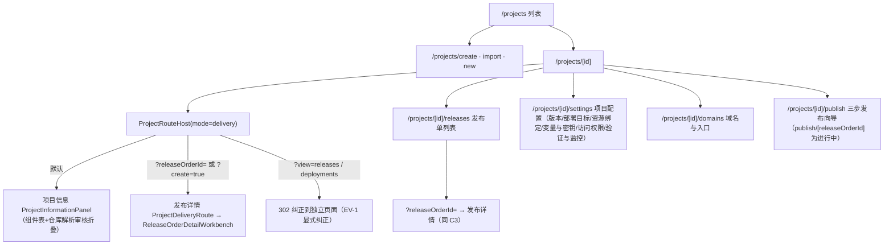
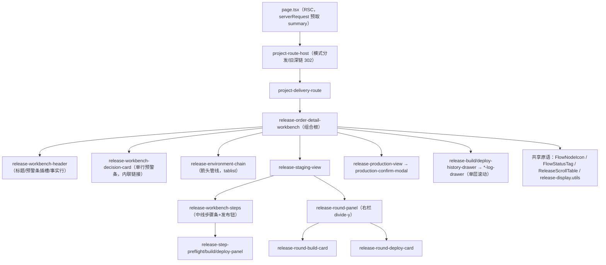
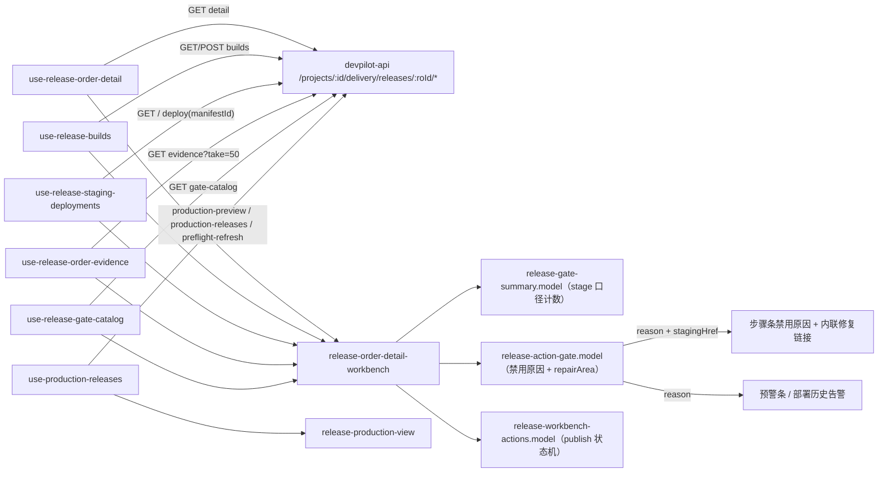
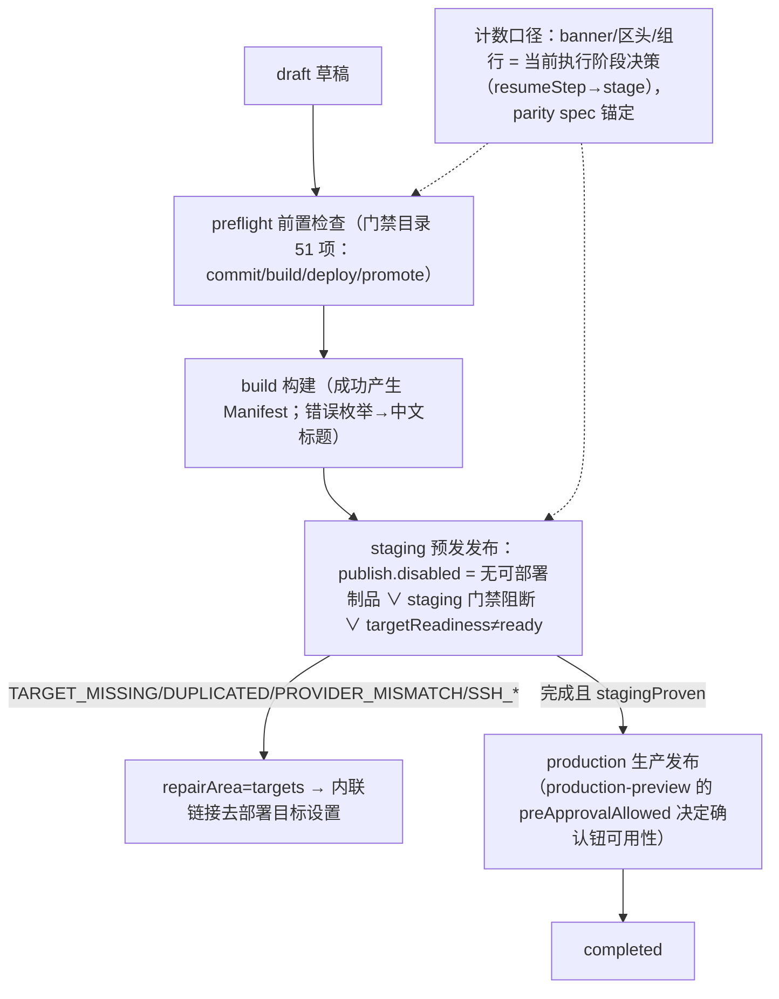

# 项目模块 UI/UX 专项审计与修复报告（2026-08-25）

- 范围：`apps/devpilot-web` 项目模块（/projects 列表、/projects/[id] 的 项目信息/发布列表/发布详情/项目配置/域名与入口、/projects/[id]/publish 三步向导）
- 方法：代码审查（路由→host→组件逐层核对）+ ego-browser 真实渲染截图走查（1800×1009 与 1280×800）
- 触发：用户 10 项反馈（1–7 为发布详情页具体问题；8–10 为全模块系统性审计）
- 截图：`evaluation/screenshots/2026-08-24/review/`（au-* 为审计前基线，fix2-* 为修复后）

## 一、五张图（依据实际代码梳理，非推测）

### 1. 页面结构图（App Router 实际路由）

### 2. 功能地图

| 页面 | 能力 | 关键组件（实测引用关系） |
|---|---|---|
| 项目信息 | 仓库事实、组件清单、解析审核折叠入口 | project-information-panel → project-component-table + tabs/repository-tab |
| 发布单列表 | 搜索/状态过滤、行操作（查看发布单/构建/部署） | release-orders-panel / release-order-list-row / release-order-create-modal |
| 发布详情 | 环境链切换、三步执行、门禁证据、构建/部署历史与日志、生产发布 | release-workbench/* 36 文件 + publish/components/production-confirm-modal |
| 项目配置 | 环境维度 版本/部署目标/资源绑定/变量与密钥/访问权限/验证与监控 | project-settings-content → settings/* 59 文件 + environment-* 系列 |
| 域名与入口 | 域名/转发目标/TLS | project-domains-* |
| 发布向导 | 选环境→确认配置→确认发布 | publish/components/publish-stepper / publish-environment-step / publish-config-step / publish-confirm-step |

### 3. 组织架构图（发布详情组件分层，其余页面同理分层）

### 4. 数据流向图（发布详情主干，端点取自 hooks 实际代码）

### 5. 业务逻辑图（发布单生命周期与门禁约束）

## 二、逐项修复记录（用户 10 项反馈）

| # | 反馈 | 修复 | 文件 | 验证 |
|---|------|------|------|------|
| 1 | 预警条「前往基线检查」应为链接并融入文案 | 删除右侧独立按钮；修复入口改为文案内内联文字链接（`，前往基线检查`），目标修复场景为内联「前往部署目标设置」链接 | release-workbench-decision-card.tsx | fix2-detail-1800.png：链接在文案尾部；spec：decision-card 3 用例改断言内联链接 |
| 2 | 环境选择改方向性步骤条 | 重写为箭头管线段（clip-path 长箭头、文案在段内、方向表达依赖）；删除外层卡片与状态文字；状态=底色+图标（选中实底）；保留 tablist 语义+方向键；FlowNodeIcon 增加 tone=inherit 防实底同色 | release-environment-chain.tsx / release-flow-nav.shared.tsx | fix2-detail-1800.png；f452/flow-nav spec 过 |
| 3 | 环境内步骤改中线步骤条、去「步骤 0x」、状态用底色/图标 | 重写为图标+名称中线连接步骤条（完成段连线走绿色）；删除序号行与状态副标；选中=主色+下划线；无外层卡片 | release-workbench-steps.tsx | fix2-detail-1800/1280.png；f453 spec 改断言新结构 |
| 4 | 具体部署不展示「当前环境版本」 | meta 行移除该字段（3 列：版本号/候选代码/最近运行）；相关 6 个 i18n key 清理（zh/en 同步） | release-workbench-header.tsx / messages | fix2-detail-1800.png；i18n parity 3964 ✓ |
| 5 | 右栏下划线奇怪 | 根因：部署信息卡（最后一节）自带 border-b 形成孤线；改 aside `divide-y`，节内不再自带边框 | release-round-panel.tsx / round-build-card / round-deploy-card | fix2-detail-1800.png：节间单分隔线，无尾部孤线 |
| 6 | 「当前步骤：0x」多此一举 | 删除副标与 releaseWorkbenchExecutionContext key | release-workbench-steps.tsx | 截图确认已无 |
| 7 | 「部署目标与当前 Provider 不匹配」无用信息 | 原因文案具体化：点名环境（预发（Staging））+ 期望目标类型（expectedProviderKey → SSH 服务器/本机目录）+ 每种 reasonCode 附动作；禁用原因旁内联「前往部署目标设置」链接（publishRepairHref 贯穿 workbench→staging-view→steps） | release-action-gate.model.ts / release-order-detail-workbench.tsx / release-staging-view.tsx / release-workbench-steps.tsx | 线上文案「预发（Staging）绑定的部署目标类型与本次发布要求的不一致（需要 本机目录），前往部署目标设置」；href=…envTab=targets&env=staging；gate model spec 更新 |
| 8 | 多层卡片/多层滚动条 | 弹层单层滚动：Drawer 新增 bodyClassName（对齐 Modal，twMerge 可覆盖 overflow）；构建日志抽屉=日志区唯一滚动层（flex-1 min-h-0）；部署/生产日志抽屉、env 导入弹窗、域名配置预览=内容平铺由弹层主体滚动；51 项门禁弹窗=摘要+chips 固定、列表唯一滚动层；页面上下文的日志/JSON 限高滚动属「内部收缩滚动」合规保留 | packages/ui Drawer + 7 个业务文件 | DOM 实测：51 弹窗 scrollLayers=1、日志抽屉=1；ui 包 contract test 新增 Drawer bodyClassName 用例（15 过） |
| 8b | 多层卡片排查 | 全模块扫描：Card 多次出现处均为兄弟卡非嵌套（latest-deployment-hero/release-policy-tab/repository-run-panel/repository-suggestion-review）；发布详情步骤条/环境链/预警条原双层卡已在本轮拆除 | — | 代码核对+截图 |
| 9 | 应为链接却用 Button | 「查看环境版本」（生产视图）与「查看部署记录」（部署日志抽屉）由 LinkButton outline/ghost 改为文字链接（保留图标）；「创建发布」为契约主 CTA 保留按钮；行内「查看发布单/查看构建/查看部署」已是链接 ✓ | release-production-view.tsx / release-deployment-evidence-link.tsx | 截图+spec |
| 10 | 过度标签/卡片轻量化 | ① 项目组件表：同名双写去重、raw「active」→本地化「活跃」（抽 utils/service-status.model 共享）、逐行重复 impact 收进 title 只留摘要行 ② 设置页当前版本空态：四列「—」占位卡→一行「暂无」虚线卡 ③ 「待生产审批」徽章 nowrap ④ 「当前环境」label nowrap ⑤ 发布向导环境卡：角色胶囊→灰字、健康胶囊→色点+文字 | project-component-table.tsx / service-status.model.ts（新增）/ applications-panel.tsx / environment-version-list-facts.tsx / environment-settings-area.tsx / publish-environment-step.tsx | fix2-overview/settings/publish.png |

## 三、回归

- devpilot-web：test 150 files / 596 tests 全过（/tmp/codex-tool-runs/svton/audit-test2.log）；type-check exit 0；lint exit 0；i18n zh/en 3964 leaf parity exit 0
- packages/ui：build exit 0（web 消费 dist 需重建）；test 15 过（含新增 Drawer bodyClassName 契约）
- 容器：web 镜像已用当前代码重建并重启（localhost:3120），线上截图即最终效果
- 视觉：1800/1280 双视口无横向溢出（scrollWidth=1280）；弹层滚动层 DOM 计数=1

## 四、遗留与建议（未修，需决策/后端）

1. 发布向导环境卡显示环境名「Production」（数据即此名，与「生产」环境并存）——属环境命名数据问题，建议在环境管理中重命名，前端不做映射猜测。
2. 页面上下文（部署记录展开行、发布向导技术输出）的限高滚动区为「内部收缩滚动」合规形态，保留；若产品希望完全平铺可后续统一。
3. tabs/ 目录下 overview-tab/releases-tab/resources-tab/settings-tab/webhooks-tab/deployments-tab/release-policy-tab/environments-tab 仅被旧引用或 spec 引用（live 面只有 repository-tab 被 project-information-panel 引用），建议后续清理死代码（本轮不动，避免误删待确认引用）。
4. 预警条 chips（51 弹窗能力组 chips）为纯展示 div[aria-pressed]——如需可点击过滤需补 role=button 与键盘行为（前轮已记录，未改）。

## 五、追加轮：门禁目录弹窗三项反馈（2026-08-25 第二轮）

| # | 反馈 | 修复 | 验证 |
|---|------|------|------|
| 1 | Mxx 标签占位大 | 15 枚胶囊改紧凑三列清单：状态色点 + 能力组名 + 通过数（n/m），完整状态入 title；高度约降为原来 1/3；当前过滤组以主色点环+加粗高亮 | fix3-gate51-full.png；DOM：15 组、滚动层=1 |
| 2 | Commit Gate 双层卡片 | 阶段区改单张外卡，内部检查项为「标题+内容」分栏行（divide-y），不再嵌套逐项小卡 | DOM：article 嵌套=0；fix3-gate-dialog.png |
| 3 | Mxx 是干什么的 | M01–M15 是后端门禁目录的能力组（capability group）稳定标识，用作过滤键与证据/原因引用；对用户无意义故全部退出界面：chips 只显名称、检查项「能力组」元数据显本地化名称、组弹窗标题去掉 M 码、阶段名本地化（提交/构建/部署/晋升门禁）、弹窗描述同步 | 全页 M 码 DOM 计数=0；i18n parity ✓ |

回归：web 150 files / 596 tests、type-check、lint、i18n 全部 exit 0；web 容器已重建，线上即最终效果（fix3-*.png）。

## 六、追加轮 2：能力组概览可点击切换（2026-08-25 第三轮）

- 反馈：概览里的能力组行无法点击切换过滤。
- 修复：能力组行改为真按钮（aria-pressed + hover/focus 环），点击切换该组过滤、再点清除回全量；过滤状态受控上提到面板（`onFilterCapabilityChange`），消除双 state 同步问题；同时移除组过滤隐含的「仅当前决策阶段」限制——此前概览显示 0/1 的组点进去是 0 项，现在组内条目数与概览 n/m 完全一致（如「资源绑定与连通性 1/4」→ 4 项，跨部署门禁）；组弹窗描述同步「再次点击上方能力组可返回完整目录」。
- 回归：web 150 files / 597 tests（新增 toggle 用例）、type-check（清 tsbuildinfo 陈旧缓存后）exit 0、lint、i18n 全过；容器已重建，线上验证「资源绑定与连通性」切换/清除均正常（fix4-group-filtered.png）。
