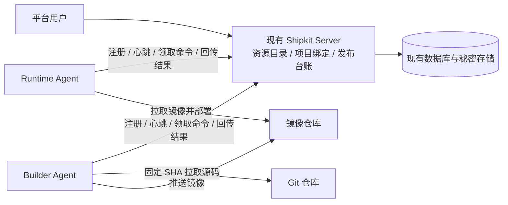

# Server 注册中心与 Agent 动态注册方案

状态：**实施中，先完成首次部署基础**。2026-10-10 基于 `44dc001d` 核对当前源码，用户已授权按模块开发、提交、逐项验收和首次部署。注册与自升级仍待对应实现和验收。实施清单见 [TODO](todos/2026-10-10-agent-registration-center.md)。

用户已确认升级顺序：先部署当前加固版，后续先升级兼容旧 Agent 的 Server，再逐台升级/登记 Agent。“安装新版本”明确指 **Shipkit 利用自身构建部署能力发布自身**；后续正常升级由平台任务发起，首次安装和故障救援仍保留独立安装入口。

## 结论与范围

由现有 Shipkit Server 同时承担 Agent 注册、资源目录、项目绑定和任务调度入口。Agent 安装后主动连接 Server，平台先登记机器，再将项目环境关联到机器。复用 Nest、SQLite、现有秘密存储、Agent Job 和发布流程，不单独部署 Consul、Redis 或另一套执行器。

推荐新模式为 **Agent 主动注册 + 心跳 + HTTPS 长轮询领取命令**，保留 CLI 和已有项目的 HTTP 直连模式。单独增加注册和心跳仍需要 Server 能访问 Agent；完整的内网接入能力必须包含反向任务通道，不能把“已注册”当成“已能发布”。首期不做自动扩缩容、跨机器自动调度、运行机器故障迁移或监控平台。

## 当前实现与差异

| 项目 | 当前实现 | 方案 |
| --- | --- | --- |
| 资源来源 | 从项目配置的 Runtime/静态 Builder 地址汇总 | 独立 Agent 资源库，未绑定项目的机器也可登记 |
| 身份 | 资源 ID 是地址摘要；换地址产生新 ID | 稳定 agentId，与 IP、主机名和隧道地址分离 |
| 接入 | 配置 URL/凭据，控制端访问 Agent API | 安装时填写 Server 地址和一次性注册码，Agent 主动接入 |
| 状态 | 点击检查时请求 `/api/status` | 心跳、会话、就绪状态和最近检查结果分别记录 |
| 通信 | Server/CLI → Agent，依赖直连或隧道 | Agent → Server 领取任务和回传结果；旧直连继续兼容 |
| 项目关联 | 同一配置文件里的连接与目标 | 项目/环境按稳定身份选择已登记的 Runtime/Builder |
| 发布恢复 | 固定 URL/凭据快照，按远端 Job 查询 | 固定机器身份和授权，重连同一机器并按 Job/游标恢复 |
| 临时构建机 | 云创建策略和控制端本地租约台账 | 创建任务限定的临时注册资源，仍保留云租约与销毁证据 |

当前代码已经具有机器认证、角色限制、操作幂等、持久 Job、日志/事件游标和重启对账；需要增加注册目录与传输适配，不能把现有执行链重写成一套通用 shell 队列。

## 用户流程与拓扑

1. 在已有“Agent 资源”菜单点击“注册 Agent”，填写名称，批准用途：运行机器、构建机器或两者；默认不授予两者。Server 生成短期、单次注册码。
2. 在机器安装 Agent，配置 Server 的 HTTPS 地址、注册码和本地数据目录。首次安装仍需要在机器执行安装命令；注册中心不会代替机器初始化。
3. Agent 主动注册并报告版本、系统/架构、Docker 状态及协议能力。注册码被消费后不保存为长期凭据，后续使用独立机器凭据。
4. 平台展示“在线/失联、运行就绪、用途、关联项目、持久/临时”。已登记但未关联的机器保留在资源目录。
5. 在项目“连接与配置”中，为每个环境选择 Runtime，并选择已有 Builder 或保留动态构建策略；发布仍先核对计划，再执行。

“Server 地址”是 Agent 访问平台注册接口的地址；“Agent 控制地址”仅用于旧直连模式；业务访问入口仍由项目服务配置管理。Agent 无公网 IP 也可用新模式，但需能访问 Server；构建及运行机器仍需按用途访问 Git、镜像仓库和依赖源。Server 不能放在只有管理员本机可访问的 localhost 地址上。

## 身份、认证和会话

- `agentId` 是稳定资源身份，`incarnation` 是该机器数据目录/任务台账的实例标识，`bootId` 是每次进程启动的标识。升级保留身份和任务数据；换机、克隆模板或丢失台账必须重新认领，不能把复制凭据当成透明替换。
- Enrollment 绑定 workspace、批准用途、期限和可选 task/lease；令牌用随机高熵值，Server 只存哈希。临时 Builder 注册资格限定于具体创建任务，不能拿去登记另一台长期 Runtime。
- Agent 在发注册请求前持久化注册尝试 ID、候选机器凭据与本地实例标识。Server 事务消费注册码并分配 agentId；相同尝试且同一凭据可以恢复丢失的响应，不产生第二个资源，不允许另一个尝试重复消费。成功后清除注册码。机器凭据在 Server 存哈希，本机文件 `0600`，父目录 `0700`。
- 长期机器凭据只访问自身的注册会话、命令和结果接口，不能登录用户 API、列出其他 Agent 或取得其他项目秘密。用途/命令授权来自 Server 的批准记录，与机器自报角色取交集；业务权限暂不限制不意味着机器认证可以关闭。
- HTTPS 必须校验 Server 证书，可显式配置私有 CA；令牌不进入 URL、日志或可分享安装链接。直连使用的 Agent API 凭据与注册机器凭据分开，仍按现有秘密存储加密保管。
- Server 事务维护 session epoch。旧会话的心跳、领取请求和 ACK 不能覆盖新会话。同一 bootId 可以重连；不同 bootId 遇到仍有效会话默认拒绝，待租约失效或显式撤销后接替，防止克隆身份同时在线。
- 心跳建议 15 秒一次，45 秒标记失联，90 秒离线，数值可配置并带抖动；时间以 Server 接收时间为准。断线指数退避重连，限制频率。Server 重启后重新认证恢复会话，不创建新机器。
- 在线只是通信存活。Docker 可用、协议兼容、批准角色满足、未禁用/排空、任务容量满足才表示可执行；业务健康仍由发布后的健康检查确认。
- 首期支持禁用/恢复、撤销并轮换凭据；删除或重新认领有在途任务的资源必须先排空/对账。普通密钥轮换有确认与旧凭据失效时点，不能长期双凭据有效；安全撤销立即阻止新命令，已经接受的操作需另行对账或尽力取消。

## 数据与代码归属

| 新增模型 | 主要内容 |
| --- | --- |
| Agent | workspaceId、agentId、名称、incarnation、批准用途、trustRevision、机器凭据哈希、持久/临时、禁用/排空状态 |
| AgentSession | agentId、bootId、epoch、lastSeen/leaseExpiresAt、传输模式、实际版本/能力、Docker/容量摘要 |
| AgentEnrollment | 注册码哈希、注册尝试、用途、过期/消费状态，可选 taskId/leaseRef；仅必要时保留短期恢复记录 |
| ProjectAgentBinding | projectId、targetKey、用途、agentId、绑定 revision；Registry/Git 凭据和业务入口不混入 Agent 身份 |
| AgentCommand | agentId/incarnation、taskId、commandId、operationId、类型、期限、投递/ACK、结果与远端 jobId；私密 payload 加密且限时保留 |

复用现有 SQLite 事务、加密存储和审计。会话可以一机一条当前记录，不持久化每次心跳；命令和日志设容量/保留策略。首期按单 Server 实例交付，不把 SQLite 复制或进程内等待表称为高可用；多实例时再引入共享队列和跨进程唤醒机制。

- API `agents/` 负责资源目录、注册、会话、绑定与机器接口，浏览器管理 API 和机器认证边界分开；Prisma schema 增加独立模型，复用 `secrets/`。
- core `shared` 定义版本化注册/命令协议与 `AgentTransport`；直接 HTTP 与注册通道为并列实现。core 通过注入的端口访问平台 gateway，不依赖 Nest/Prisma，也不靠伪造 URL 接入注册通道。
- Agent 增加 registration client、session/identity store、command consumer；现有命令处理器抽出可复用业务调用入口，保持角色、参数、幂等与原子提交检查。反向通道不是任意路径代理或任意 shell 执行接口。
- CLI pipeline、`apiUpload`、JobObserver、reconcile/cancel/history/rollback 全部经传输端口访问 Agent；不能仅迁移 build/deploy 而遗漏取消和日志读取。
- 安装源 `bootstrap/src/` 配置 Server 地址、CA 与注册模式；更新生成安装脚本和离线安装包。Server 地址等启动参数保存在机器 `/etc/shipkit/agent.env`，身份/机器凭据保存在 Agent 数据目录；升级保留、卸载明确保留策略。现有本地 HTTP 服务在注册模式可仅监听 loopback 供诊断。

## 任务通信与失败恢复

推荐 HTTPS 长轮询，单次等待约 25 秒，反向代理超时应更长；注册/心跳单独处理，不被长任务阻塞。首期用现有 Node HTTP 能力，无需先引入 WebSocket 框架。对状态与日志查询保留独立并发通道和额度，避免构建占用命令槽导致取消、日志或心跳饥饿。

1. Server 在持久命令箱写入受限操作：状态、构建、推送、部署、历史、查询 Job、日志/事件、取消等。包含 agentId/incarnation、项目/环境、executionId、operationId、requestHash、协议版本、期限和最小角色授权。
2. Agent 认证领取仅发给自己的命令，检查身份、授权和期限；变更操作复用 `operationId + requestHash`，持久记录后回复 ACK 与 jobId。ACK 是接受证据，最终成功由 Job 结果及健康检查确认。
3. 通信至少一次投递。超时不能猜测“没执行”后生成新 operationId；同一命令重投返回同一 Job 或参数冲突。命令状态包含 accepted/unknown/expired，避免把网络失败写成业务失败；不宣称任意副作用 exactly-once。
4. Agent 本地 Job journal 是远端执行证据；Server 继续保存 RemoteJob 和日志/事件游标，断线后先按 operationId 查找任务，再补读原 Job。日志增量分块、按游标去重、限制大小；Server 持久化成功后才确认相应游标。
5. Server 断开时停止发新命令，Agent 已接受的 Job 遵循现有执行阶段和取消规则，不因网络断线终止已提交部署。Agent 进程重启仍将未终态 Job 标失败并要求 reconcile；不会承诺自动续跑 Docker build。
6. Runtime 失联不自动改派。取消也是可能未送达的命令，平台显示请求/确认/过晚的实际结果。云资源释放按现有台账、销毁定时器、SDK 确认和补偿链路执行；心跳离线不等于实例已销毁。

镜像继续在 Registry 流转，Git 完整源码仍由 Builder 拉取。Server 保存元数据、命令和既有日志归档，不保存每台机器的完整仓库。旧“本机目录”发布所需 tarball 在反向模式用认证的临时上传/下载通道，限制大小/TTL/配额并在确认后清理；不能把大二进制塞进 SQLite 命令 JSON。临时 Builder 释放仍必须等待必要日志归档完成。

## 发布快照与兼容迁移

这是本次方案最关键的兼容边界：当前私有指纹包含整个连接配置和 resolved runtime 的 URL/token/CA。不能修改旧快照中的 URL 后直接放行，也不能删掉指纹检查。

- 新增有版本号的 registered transport 快照，固定 `agentId + incarnation + trustRevision + bindingRevision + approvedRole + requiredCapabilities`，并继续固定源码 SHA、配置版本和运行基线。会话/长轮询连接属于短期路由，执行时只能解析为这一身份的已认证通道。
- 同一身份的 IP/会话变化不改变计划；身份、绑定、授权或信任变化、必需能力不足使计划失效。正常凭据轮换不改变机器身份；批准的信任版本变化仍要求重新核对。原 direct 快照继续冻结 URL/凭据，不静默转换旧计划。
- RemoteJob 新记录包含 agentId/incarnation，URL 仅作旧直连/诊断信息；唯一键、发现、恢复、取消、日志和回滚都以原身份定位。旧记录按旧协议恢复，不把相同 jobId 或同地址视为同一机器。
- 动态 Builder 的计划固定创建策略和任务租约要求，实际 agentId 在创建/认领阶段一次写入任务台账，此后不可替换。注册资格绑定 task/lease/provision nonce；云创建返回的实例记录与登记信息受控关联，不能相信 Agent 自报 instanceId 就认领其他实例。
- 临时构建机仍可能需要出站互联网访问 Git/Registry；反向控制只消除 Agent 入站端口和对应公网寻址依赖，不能承诺所有云网络配置都无需公网 IP。
- 旧项目配置继续走 `legacy-configured` 模式，先导入连接视图而不是假造“已注册/在线”记录。显式认证认领并选择资源后才迁移项目；历史任务/回滚数据保持可读。相同地址不自动合并凭据、机器身份或权限。

## 首次部署与 Shipkit 自发布

首次就采用独立 Builder、宿主 systemd Runtime Agent、由该 Agent 管理的 Shipkit Server/Web 容器。先补固定提交的 Dockerfile、`ship.yaml`、生产入口及健康检查，再引导安装当前加固版并将 Shipkit 自身登记为 Git 项目。数据库/归档日志/配置目录和原加密主密钥外置持久化；需要的宿主目录/卷提前创建并授权。Server 容器不嵌入管理它的 Agent，不挂载宿主 Docker socket。

当前 v2 服务定义已支持外部卷和受限宿主绑定；Agent 可以独立完成已接受的 Runtime Job，Server 重启后恢复观察原任务。但仓库目前没有 Shipkit 自身的生产 Dockerfile/发布定义，也没有受控 Agent 自升级动作，不能把普通业务发布当成这两项已经可用。

| 自发布对象 | 平台发布方式 | 独立执行与恢复 |
| --- | --- | --- |
| Server/Web | 固定提交 → Builder 构建镜像 → Registry → 宿主 Runtime Agent 更新容器 | 已接受的部署 Job 在宿主执行；新 Server 启动后按 executionId/jobId 补录结果 |
| Agent | 固定提交 → 构建并校验版本化升级包 → 受控宿主升级任务 | 独立宿主升级程序接手，复用安装器的替换/重启/健康核验/失败回退；原 Agent 不同步等待自己重启 |

自发布使用专门的任务类别和准入检查，复用来源 SHA、计划、版本、构建/推送、日志与审计。命令只允许批准的目标、包摘要、版本和固定升级动作，不能因需要 root 权限开放任意脚本执行。目标 Agent 先排空其他任务；Builder 升级由另一台 Builder 提供构建产物，单台场景可先产出并校验完整包再停止构建进程。

Server 自发布先限制其他变更任务，固定输入并将完整执行指令与敏感引用安全交给独立宿主任务；持久化交接确认后允许停止 Server。停止旧进程、取得维护锁、备份、迁移/启动和验证由宿主完成，不能要求旧 Server 自己完成升级后的记录。升级结果保存在 Server 生命周期之外，新 Server 启动后恢复原发布台账；断线/重启状态不等于成功。

当前平台备份工具拒绝活跃/未解决任务，并与平台启动器竞争独占 `.ops.lock`。自发布需要专用、受限的维护交接协议：只允许当前已交接的自发布任务等待完成，其他任务必须排空；旧 Server 停止后由宿主取得锁再备份。不能直接绕过现有备份保护，也不能让 Server 持锁等待一项必须先停止 Server 的备份。

SQLite 单写者要求旧 Server 完整退出后再使用同一数据库。迁移前保存数据库、日志和匹配代码，并安全保存原主密钥；新版本失败时仅在迁移兼容得到证明时切回旧代码，否则恢复迁移前数据与匹配代码。不能把通用镜像回滚当成数据库回滚。迁移后保持独占维护期，完成受限检查前不接受新业务写入；代理/入口负责维护状态和升级后恢复。

Agent 升级保留角色、连接、数据目录及身份/任务台账。首次启用注册协议时创建/认领稳定身份并显式迁移项目绑定，不改写历史 direct 快照。升级程序必须在 Agent 生命周期之外保留升级结果；新 Agent 启动后核对该结果，不能因现有启动恢复把在途 Job 标 failed 就丢失升级事实。涉及本地台账格式升级也需要兼容/备份与回退证明。

验收要从当前实际部署版本开始，通过 Shipkit 页面构建和发布新 Server，观察控制面断开及恢复、原任务最终结果、数据/秘密保留；再发布 Agent 升级并检验身份保留、注册迁移和故障回退。保留宿主安装/恢复命令作为平台不可访问时的救援入口，正常升级无需手工执行这些命令。

## 分期与验收

| 阶段 | 交付和准入 |
| --- | --- |
| A 注册基础 | 独立 Agent 库、一次性注册、身份、会话/心跳、禁用/撤销、现有资源菜单；可用直连做中间验证，但明确仍要求网络可达 |
| B 完整通信 | 长轮询命令箱与双传输适配，状态/build/push/deploy/history/cancel/log/source 完整覆盖，断线与重启对账 |
| C 发布关联 | 项目按身份选 Runtime/Builder，版本化快照、RemoteJob 迁移、临时 Builder 自动注册与原云清理链路 |
| D 产品验收 | 安装升级/离线包、资源状态/用途/关联、未登记/未就绪修复动作、浏览器与真实隔离发布验收 |
| E 自发布 | 首次部署先完成 Server 镜像/发布定义与持久化布局；后续补齐宿主升级任务、维护交接、数据迁移/回退和 Server/Agent 页面自发布验收 |

**首个“动态注册可发布”版本必须完成 A–D。只有 A 的注册列表不能作为功能完成。** 权限模型预留 workspace/actor 与机器 scope，按当前约定暂不引入面向用户的业务操作限制。

**“Shipkit 可以发布自身”还必须完成 E，Server 和 Agent 分别验收。** 首次部署的包装与布局先实施；注册改造完成后按“Server 兼容升级 → Agent 灰度升级/注册 → 项目绑定切换”的已确认顺序上线。

验收必须覆盖：重启后 ID 保持且会话更新；注册码超时/重用/丢响应；旧 epoch 与复制身份并发；伪造角色和跨 workspace；Agent 无入站端口的真实双服务 Git 发布；Docker 不可用；Server 在写命令后/收到 ACK 前重启；命令重投不重复部署；断线与 Agent 重启对账；完整日志补读/取消；同身份重连不换机、换机/丢台账使旧计划失效；旧直连历史/回滚；config-only/rollback 在 Builder 离线时成功；临时 Builder 登记、归档和云销毁证据分别确认。

## 源码核对入口

当前 CodeGraph 未返回 Shipkit 的 AgentService，以下影响图由限定路径的源码阅读核对，未以旧索引推断不存在功能。

- [资源清单服务](../../apps/shipkit-api/src/agents/agent.service.ts)、[地址摘要 ID](../../apps/shipkit-api/src/agents/agent.view.ts)、[连接及即时检查](../src/platform/agent-connections.ts)。
- [当前 Agent 启动及认证](../src/agent/server.ts)、[状态/Job 查询](../src/agent/routes-lifecycle.ts)、[配对存储](../src/agent/security.ts)、[操作幂等](../src/agent/job-operations.ts)。
- [快照捕获](../src/platform/capture-project.ts)、[私有指纹](../src/platform/private-fingerprint.ts)、[执行校验](../src/platform/execute-task.ts)、[远端 Job 发现](../src/platform/reconcile-jobs.ts)、[游标归档](../src/platform/job-observer.ts)。
- [项目模型](../../apps/shipkit-api/prisma/schema/projects.prisma)、[远端 Job/资源租约](../../apps/shipkit-api/prisma/schema/ledger.prisma)、[云构建机创建](../src/providers/tencent-provision.ts)、[安装参数源](../bootstrap/src/00-params.sh)。
