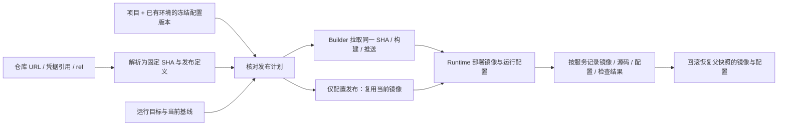

# Git 仓库接入与版本化发布配置

状态：本机实现与隔离验收已完成；浏览器验收待新的接管许可。设计基线 `899f02ee`；本轮不部署生产、不推送。`shipkit/0.0.1` 保留原冻结基线。实际证据见[实施验收报告](audits/2026-10-09/git-source-versioned-config.md)。

## 目标与推荐边界

用户在平台填入仓库地址即可接入项目，不再手工 clone 到平台服务器；平台管理环境变量的草稿和冻结版本，发布关联一个确定版本。两个能力最终形成可复现的发布输入：**固定源码提交 + 发布定义 + 各服务的配置版本 + 运行目标 + 当前部署基线**。

“动态”在首期表示配置由平台管理、选择并随发布生效。保存或冻结配置不修改线上进程；不做绕过任务台账的热更新。平台自身的启动参数、TLS、云凭据和业务容器环境变量分别管理。

推荐保留 Next/Nest/SQLite、CLI 构建部署链及 Agent。新增仓库来源模块和配置版本模块，不建设独立 Git 托管、配置中心或外部 Vault。登录后业务操作仍全部开放，继续保留现有 authorizer 的资源范围与审计扩展点。

## 已确认的现状和影响图

| 链路 | 可复用部分 | 必须补齐 |
| --- | --- | --- |
| 项目登记 | 项目/环境/服务及 actor/workspace 元数据 | `rootPath` 当前必填且检查本机目录；增加仓库型来源 |
| 来源与定义 | schemaVersion 2 的 `ship.yaml`、spec 校验 | Git 计划当前本机 `rev-parse`；平台自动取得固定提交及定义 |
| 构建 | Builder 已支持 HTTPS Git clone/fetch、tarball、Dockerfile/context | 严格比较计划 SHA 与每服务构建结果 SHA；认证不进入 URL/argv |
| 发布计划 | 指纹、有效期、运行基线、并发锁、幂等任务 | 绑定仓库来源修订与不可变配置引用；秘密不进公共快照 |
| 环境配置 | CLI 读取 envFile，Runtime 接收 `envFileContent`/keepEnv | 平台编辑、加密保存、版本冻结和按服务关联 |
| 回滚与恢复 | Agent 全组合快照含服务镜像、定义、来源、env；任务重启对账 | 快照持久化配置引用及兼容能力检查；恢复时配置密钥和脱敏值池可用 |

源码核对的入口：API `projects/project.service.ts`、`tasks/plan.service.ts`、`tasks/task-runner.service.ts`；core `platform/{project-context,plan-fingerprint,execute-task}.ts` → `cli/{pipeline-multi,pipeline-group-deploy}.ts` → Agent `source.ts`、`group-{merge,activation,snapshots}.ts`。本次用限定路径的源码阅读建立影响图。

## A. 直接接入 Git 仓库

### 用户流程

1. “接入项目”提供“Git 仓库 / 已有目录”。Git 输入 HTTPS 仓库地址和凭据引用，公开仓库无需凭据。
2. 平台检查连接，读取真实默认分支；用户选择分支、标签或 commit，以及发布定义路径，默认仓库根目录 `ship.yaml`。
3. 从确定提交读取并校验服务定义，展示服务、构建上下文和 Dockerfile，绑定已有连接配置中的 Runtime/Builder/Registry；核对后登记。
4. 创建发布时选择 ref 和服务。核对页展示请求的分支/标签、最终 commit、运行目标和服务变化；执行固定 commit。

仓库维护入口放在项目“连接与配置 → 仓库”。不新增全局仓库导航。初次缺少 `ship.yaml` 时引导提交定义；不猜测 Dockerfile 或假装项目已可发布。

### 来源模型和平台缓存

- `ProjectSource` 为 `directory | repository`：旧目录项目保留 rootPath；仓库项目保存规范化 repoUrl、credentialRef、默认 ref、specPath、来源 revision，不要求用户填写 rootPath。
- `SourceSnapshot` 保存 repoUrl、specPath、sourceRevision、请求 ref 的类型和值、resolved commit、spec 内容/摘要及发现的服务。Project 可以更新默认 ref；已经核对的计划只引用自己的快照。
- `RepositorySourceResolver` 归 core `shipkit/src/platform` 所有，API 负责登记/审计/持久化，Web 只调用受控 API。CLI 与平台复用已有 spec 校验、URL 规范化和 Builder Git 管道。
- 平台优先调用 GitHub / GitLab / Gitea 元数据 API，只读取提交与该 SHA 的发布定义。generic HTTPS Git 使用受大小与超时限制的临时 shallow fetch，读取后清理；完整源码只在 Builder Agent 拉取。
- 临时读取使用独立目录，不共享可变工作区；Git 禁用非必要 hooks/filters，认证临时文件在结束后清理。计划保存 SHA 与 spec，不依赖平台仓库缓存长期存在。
- specPath、Dockerfile、context 均相对仓库根解析，允许 monorepo 的子路径；用现有 `loadSpecAnyFile(repoRoot/specPath)` 读取指定文件，不靠改变 cwd 到 spec 子目录适配。检查真实路径和 symlink，禁止逃逸到仓库外。首期不提供第二套隐含 project-subdir 规则。
- 服务增删/定义变更必须在计划中核对；正在运行的服务删除继续要求显式迁移，不能由某次 ref 更新静默删除。
- 登记时固定 `appName=spec.name`；新 ref 改变 appName 拒绝并要求显式迁移，否则会启动新 group 而留下旧容器。登记检查平台已有项目与 Runtime 绑定，避免同一 Runtime/app/env 重复登记；Agent 仍是最终绑定校验者。

### 不可变构建与凭据

生成计划时将 branch/tag 精确解析（注释标签 peel）为 commit，固定该 SHA 的 spec。Builder 继续接收 `{type:git, repo, ref:SHA}`；每个服务构建返回的 SHA 必须存在并相同，才允许推送/部署。分支推进、标签移动或 force-push 不会重定向旧计划；原 SHA 已不可取得时明确失败，不能回退到分支最新代码。

仓库提供非秘密构建定义；平台提供部署连接与凭据，仓库内 `ship.config.yaml` 不自动加载。登记来源覆盖连接配置中的旧 `source` 字段，防止计划校验仓库 A、实际构建仓库 B。仍复用原 canonical projectIdentity；缓存目录变动不能改变 Runtime 绑定。

首期凭据采用限定仓库范围的 HTTPS 只读 token，以受控临时 Git 认证传递，token 不进入 URL、命令参数、Git remote 持久配置、公共计划或日志。平台与 Builder 均需获得对应读权限；平台可按任务把最小必要凭据通过受保护 Agent 连接交付，而不是把所有平台凭据同步到 Agent。

仓库 URL 只允许无内嵌凭据的 HTTPS；部署管理员配置允许访问的 Git 主机，平台与 Builder 均校验 DNS/IP 和重定向目的地，不能拿表单 URL 探测任意内网。自建 Git 可显式加入允许范围。ref 与路径拒绝选项注入；缓存/拉取设超时、大小和输出上限。凭据撤销、鉴权失败、ref 不存在、定义无效分别显示具体修复动作。

首期不支持 SSH Git、OAuth 安装、Webhook 自动发布、submodule、LFS；遇到依赖这些能力的仓库明确提示，不静默构建缺文件的项目。

## B. 项目运行环境配置版本

### 产品位置与版本规则

在项目“连接与配置 → 环境变量”管理，环境选择对应已有 `targetKey`。模块在代码和数据层独立，界面仍是项目子页面，不放全局系统管理导航。首期每个“项目 + 环境”一个配置集，内含多个服务；不建设全局跨项目继承树。

版本使用“名称 + x.y.z”，例如“生产基础配置 · 0.0.1”，与发布版本独立编号。草稿可修改，用 etag/revision 防止并发覆盖；“冻结为版本”原子分配编号，冻结后不可修改。编辑已有版本创建新草稿；可归档并禁止新计划使用，历史任务引用的版本不得物理删除。

变量以 key/value 表格编辑，支持导入单行 `.env`；导入不展开变量，值默认标为秘密。公共默认值与服务专属值在冻结时展开成每服务完整 map；服务值覆盖同名公共值，核对页显示最终键集合。秘密标记只影响读取展示；全部值均加密保存。

变量名校验，重复键拒绝，空字符串有效。set/delete 为明确操作，省略值表示保留已有值，掩码绝不能作为实际值保存。删除公共键与删除覆盖值分别说明结果，不隐含删除已冻结版本。首期仅支持 UTF-8 单行值，拒绝换行/NUL；`.env` 与 Compose 解析的 `$`、`#`、空格、引号、空值必须往返保真，不能靠 shell 拼接或变量展开实现。

### 数据与秘密保存

| 拟新增对象 | 内容与责任 |
| --- | --- |
| ProjectSource / SourceSnapshot | 仓库连接元数据、来源修订与固定 SHA/spec；与秘密引用分开 |
| RuntimeConfigSet | projectId + targetKey，展示名和默认推荐版本；环境不能由客户端任意跨项目引用 |
| RuntimeConfigDraft | 基础版本、etag、按服务变量、创建/更新 actor；可变编辑工作区 |
| RuntimeConfigVersion | 唯一版本号、parentId、冻结时间/actor、覆盖服务、加密变量与 keyId；不可变 |
| ReleaseConfigBinding | Plan/Task 所选服务的 mode 与版本引用；Runtime 快照保存每服务实际 configRef |
| ConnectionSnapshot | Plan 固定的 endpoint/TLS CA/provider/registry、来源 configDigest 和版本化私密引用；Task/恢复不读取新连接 |
| CredentialRef / CredentialVersion | Git/连接凭据的用途、范围、不可变 revision/keyId 与加密正文；使用记录绑定实际版本 |

API 的 `secrets` 模块单独拥有加密存储与密钥加载，Git 凭据和环境配置复用它。core 通过受控私有 resolver 端口取得任务需要的秘密，不反向依赖 Nest/Prisma；resolver 不序列化到计划、不提供浏览器任意解密接口。

继续用 SQLite，结构化载荷按现有方式序列化 String，秘密载荷使用专门存储路径，不经 `encodeJson/publicData`。使用 Node 内置 AES-256-GCM、随机 nonce、AAD 绑定对象/项目/环境/服务和修订；避免跨项目挪用密文。草稿冻结时按旧 AAD 解密、按新版本身份和新 nonce 重新加密，再事务提交；保留值的草稿修订也遵循对应 AAD，不能直接挪用旧密文。失败不留下半冻结版本。配置指纹涉及秘密时用私有 HMAC，不公开低熵秘密的裸 SHA 摘要。

主密钥独立保存在平台服务器私密目录，例如 `/etc/shipkit/keys/` 的 0600 文件，通过 `SHIPKIT_SECRET_KEY_FILE` 引用；DB 只存密文和 keyId。密钥缺失/错误时拒绝需要解密的操作；存在密文时绝不自动生成替代密钥。保留 keyId 和历史密钥供轮换/恢复。

秘密读取 DTO 仅返回键、类型与 hasValue；编辑替换通过写接口，普通变量允许展示明文。公共 API/Plan.snapshotJson/Task.output/events/audit 不得携带秘密正文，不能依赖现有按字段名过滤任意变量值。脱敏值池覆盖本次配置、基线继承配置、失败恢复及回滚父快照，并按实际使用的凭据版本加载。旧文件配置可能只能由 Agent 取得，Agent 须在 journal 落盘前过滤实际旧/新 env；平台再过滤公开归档。无法取得必要值池时不直接公开或落盘原始远端日志。

平台解密后仅将所选服务的运行配置通过 HTTPS/SSH 隧道送到 Runtime，不发给 Builder。Runtime 必须使用明文 env 启动容器，现有 `runtime.env` 与回滚 env 快照为 0600 明文文件；不能宣称所有机器上都没有明文。Agent 存储和备份也按秘密保护。

### 发布绑定、继承和回滚

发布核对前明确选择配置策略：**应用冻结配置版本 / 继承当前配置 / 旧 envFile**。策略互斥，不叠加优先级猜测。旧项目 `keepEnv=true` 对应继承；旧文件方式保持兼容，但仓库新接入项目推荐平台版本，不读取 Git 里的生产秘密。可从平台服务器已有私密 envFile 显式导入草稿，核对后冻结。

- 已部署服务默认继承自己的当前配置，核对页逐服务展示来源版本；首次部署必须选择完整配置版本或明确声明无需环境变量。
- 新版本必须覆盖本次选中的每个服务；缺少某服务配置不能默认清空。清空配置是明确操作，可在版本中声明该服务无需变量。
- 未选服务完整继承其镜像、定义、来源与配置。部分发布可能形成 `backend=配置0.0.2`、`admin=配置0.0.1`，因此不能只给整轮发布一个“当前配置版本”。
- Plan 绑定固定 configVersionId/摘要、source snapshot、ConnectionSnapshot、服务范围、targetKey 和当前 Runtime 基线；Task 在事务中继承绑定，再获取现有 activeScope 门禁。首次远端 POST 前持久记录实际使用的配置/连接/凭据版本及远端意图。不是执行时读取“最新配置”。
- 新冻结版本、默认推荐版本、分支前移和 configPath 内容更新只影响新计划，不改变固定输入。未执行计划若项目身份/运行目标被显式迁移则重新核对；已有任务始终沿原连接快照、TLS 材料和实际 leaseRef 观察、取消、恢复与 cleanup，不改连新机器。
- 远端对账与执行前源码解析分开：对账使用 Task 冻结的 spec/连接/私密引用，不 fetch Git、不要求仓库缓存或 Git 凭据可用。凭据撤销禁止新网络操作，保留历史解密材料用于脱敏；连接/密钥不可用或远端状态未知时保留 interrupted 门禁，进行人工修复，不能当作旧任务未执行而放行。
- 每服务 configRef 扩展到 Agent wire/store/snapshot/history；用新能力标识检查 Runtime 支持，不让旧 Agent 静默丢失关联。旧快照显示“历史文件配置”，不要编造版本号。
- 回滚恢复所选历史变更父快照中的镜像、env 和 configRef，不应用最新配置。Agent 快照过期、旧 env 缺失或对账不确定继续拒绝回滚；平台长久留存记录不代表快照永久可用。

### 仅更新配置与构建变量

提供同一发布工作台里的“仅更新运行配置”：选服务与配置版本，复用当前 digest-pinned 镜像、spec、源码 provenance，仅重建受影响容器并健康检查；构建机/构建/推送/释放阶段标记跳过。仍生成发布版本、任务、基线门禁、审计及回滚快照；不是直接改在线 env 文件。不允许首次部署或来源不明/未固定 digest 的镜像使用此快捷路径。

该路径新增明确的 `kind=config-only`，从普通源码发布分支分离；不解析最新 Git ref、不加载新提交的 spec，也不要求 Builder 或仓库在线。以经过身份/环境绑定检查的 Runtime 当前组合为输入；平台版本模式不读取旧 envFile，继承模式只验证基线。提交代码和仅更新配置是两个明确模式，不因新提交出现而混入代码变更。

运行变量与构建变量必须分开。`NEXT_PUBLIC_*`、Vite 等在前端构建时固化，运行配置不能修改镜像里的值；这些变更要求新构建。首期运行配置表不自动注入 Docker buildArgs，识别常见构建前缀后给明确说明。已有 ship.yaml 的公开 buildArgs 保持现有规则。未来构建配置版本另行进入构建指纹与镜像 provenance，秘密不得通过普通 ARG；BuildKit secret 挂载需要单独协议，不在首期范围。

## 存储、迁移与恢复

| 内容 | 推荐位置与迁移策略 |
| --- | --- |
| 平台启动参数 | 现有私密 EnvironmentFile；不进入业务配置模块 |
| 项目/源码快照/配置版本/密文 | 现有 `SHIPKIT_DATA_DIR/platform.db`；Prisma 增量迁移 |
| 仓库读取 | Provider API 元数据；generic 临时目录读取后删除。平台不持久托管完整仓库 |
| 解密/HMAC 密钥 | 数据目录之外的私密 key 文件；独立备份、限制权限，不入 Git |
| Runtime env 与回滚快照 | Agent 所在机器；与平台 DB 分别备份和验收 |

旧 Project 补记 directory 来源，保留 rootPath/configPath、projectIdentity、历史和任务。不自动把目录项目改成仓库身份；本地 identity → repo identity 的变更须显式检查 Runtime 绑定，不能造成部署冲突或接管。旧 envFile 不自动复制入 DB，不改变正在运行的配置。既有 configPath 首期仍可提供连接 profile；仓库接入不要求业务源码已有本机目录，但连接资源需要事先配置。

备份继续使用现有 [platform_ops.py](../ops/platform_ops.py) 的离线一致性 DB/log 工具（既有隔离验收见 [MVP 加固报告](audits/2026-10-09/mvp-hardening.md)），增加密钥与凭据的独立加密备份流程；仓库缓存默认可重建，未推送源码不能因此被视为可恢复。演练 DB + 正确历史密钥 + Agent 快照；缺密钥或快照不得当作恢复成功。运行配置不会备份/迁移业务数据库。

## 实施顺序与验收

以下为本轮实现范围，具体已通过的检查以验收报告为准；不改旧 `shipkit/0.0.1` 标签。

| 阶段 | 实现切片 | 必须证明的结果 |
| --- | --- | --- |
| 1：仓库项目 | 来源/连接快照、Resolver、托管缓存、共享加密存储/Git 凭据、项目接入/维护、SHA 对比 | 干净服务器只填仓库即可真实构建；无需人工 clone；原目录项目仍可发布 |
| 2：配置版本 | 加密存储、草稿/冻结 API、项目环境变量页面、Plan/Task/Agent configRef | 版本不可变，秘密不进公共响应，正常发布绑定准确，部分服务继承正确 |
| 3：集成能力 | 仅配置发布、配置差异、回滚与恢复、Agent 兼容提示 | 零新构建复用镜像，更新后检查生效，失败恢复/历史回滚含对应配置 |

Git 验收：公开/私有仓库；branch/tag/commit；monorepo；缺 spec/ref/权限；branch 前移/force-push；并发计划/缓存；重启后固定 SHA；构建 SHA 缺失/不一致阻断推送；凭据不落 URL/argv/log；URL 重定向/路径逃逸拒绝；不支持的 LFS/submodule 明确提示。

配置验收：草稿并发、唯一版本冻结；新草稿不影响旧计划；空值/删除/掩码更新；覆盖和缺失服务；`.env` 字符往返；跨项目/环境引用拒绝；未选服务不受影响；计划过期/旧基线阻断；退出/登录与日志中无秘密；密钥丢失拒绝、完整备份恢复、旧项目和快照兼容。

集成验收：隔离多服务项目用固定 commit + 配置版本发布，重启平台后对账，部分更新、仅配置更新、故障恢复、历史回滚都实际检查容器值与 SHA/digest/configRef；用非真实秘密检测泄漏。桌面与 390px 逐项验证项目接入、配置编辑/冻结、发布核对、日志步骤切换、结果和历史。正式环境验证另行授权和选定目标，不用生产 TWGG 代替隔离验收。

现有 MVP 可继续部署；这两项是后续能力升级。仓库项目全流程验证和配置版本绑定通过前，不宣称平台已经支持“只填 Git 地址 + 在线选择配置版本”的发布方式。
